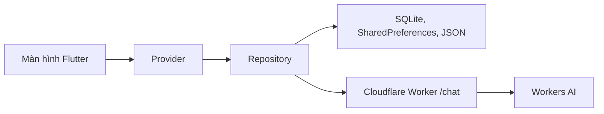

# Tổng quan và kiến trúc Edumaster

**Học phần INT1449 · PTIT · Lớp INT1449-20261-02 · Nhóm F**

## Mục đích và vai trò

- **Giáo viên:** tạo phòng thi, đặt thời gian, chọn nguồn đề, sinh mã QR, xem tiến độ và kết quả cục bộ. Giáo viên tạo, đổi tên, xóa nhóm và thêm sinh viên bằng ID trong bảng `users`. Bảng xếp hạng nhóm hiển thị EXP. Tài khoản GV không tích streak.
- **Sinh viên:** luyện tập song ngữ, làm lại câu sai, thi thử tính giờ, tra từ điển, hỏi AI Tutor và xem thứ hạng theo EXP. Chuỗi ngày cá nhân nằm trong **Chuỗi & Huy hiệu**.

## Các lớp và thư mục

| Thư mục | Trách nhiệm |
| --- | --- |
| `lib/presentation/` | Màn hình và `ChangeNotifier` quản lý trạng thái. |
| `lib/domain/` | Mô hình dữ liệu và giao diện repository. |
| `lib/data/` | Triển khai repository, đọc asset, thao tác SQLite, SharedPreferences và HTTP. |
| `lib/core/` | Theme, hằng số và widget dùng chung. |
| `assets/data/` | Ngân hàng trắc nghiệm và từ điển gốc. |
| `ai-backend/` | Worker phục vụ AI Tutor qua HTTPS. |
| `test/` | Unit test, widget test và kiểm tra trợ năng. |

Ứng dụng dùng Provider để màn hình nhận thay đổi trạng thái và hiển thị lại khi dữ liệu cập nhật. Dữ liệu lớp học hiện được đọc từ kho cục bộ. Worker xử lý yêu cầu AI Tutor qua HTTPS.

[Xem giới hạn đồng bộ và vị trí lưu dữ liệu](04_CHINH_SACH_BAO_MAT_DU_LIEU.md).
